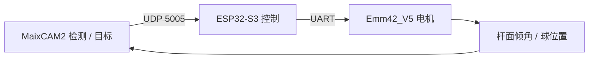

# 车载平衡滚球控制

MaixCAM2 / UDP / ESP32-S3 / ESP-IDF

[现场演示与项目介绍](https://dgwfpga.cn/showcase/ball-balance.html) · [地瓜丸的 FPGA 教学平台](https://dgwfpga.cn/) · [验证范围](VALIDATION.md)


相机给出球与目标的位置，ESP32-S3 执行周期控制，再由电机改变杆面倾角。这里发布原归档中时间较新的“决定版”相机／控制器配对，不混用早期 C 固件和后期相机协议。



## 文件地图

- `maixcam/ball_udp.py`：目标检测、位置滤波、触屏设定与 UDP 数据发送。
- `esp32/main/main.c`：球速估计、状态切换、控制量与输出整形。
- `esp32/main/emm42.c`、`emm42.h`：电机通信。
- `esp32/main/mpu6050.c`、`mpu6050.h`：同工程根中的 MPU6050 驱动，补齐决定版引用的源文件。
- `esp32/main/config.example.h`：公开配置模板，网络信息已替换。
- `esp32/README.md`：原工程接线及上电顺序。
- `docs/control-notes.md`：原控制迭代笔记，部分参数为不同试验阶段的记录；实际参数以配对源码为准。

## 配置与构建

使用 ESP-IDF 的 ESP32-S3 开发环境。在仓库根目录执行：

```powershell
Copy-Item esp32/main/config.example.h esp32/main/config.h
# 编辑 config.h 中的 WIFI_SSID / WIFI_PASS，再核对 GPIO 与控制方向
cd esp32
idf.py set-target esp32s3
idf.py build
idf.py -p <你的串口> flash monitor
```

`config.h` 被 Git 忽略，不要提交自己的热点凭据。默认值不能直接连接网络。

相机与 ESP32 需在同一网络。相机脚本发送 `B,seq,ball_cm,target_cm` 或 `N,seq`。模型权重不随代码分发：从你自己的训练导出 MaixCAM2 对应模型，核对 `MODEL_FILENAME`、类别标签与部署路径。MaixCAM Pro 与 MaixCAM2 的模型产物不能凭扩展名相似就直接混用。

先核对供电、原点和输出方向，再按 `esp32/README.md` 联调。控制笔记中的目标时间、参数和早期现象不作为本次复测的性能承诺。


## 许可与贡献

项目代码按 [MIT](LICENSE) 发布，依赖与原始署名见 [NOTICE.md](NOTICE.md)。欢迎附上所用硬件、固件／工具版本、复现步骤和日志提出问题；请先去除自己的网络密码和设备信息。
